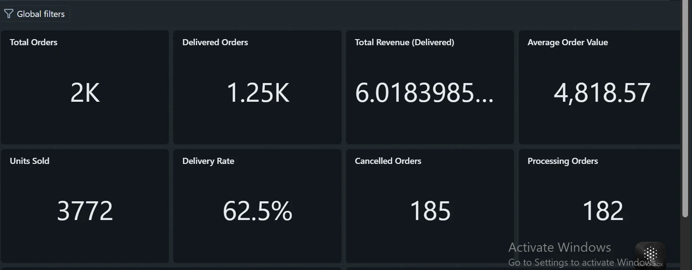
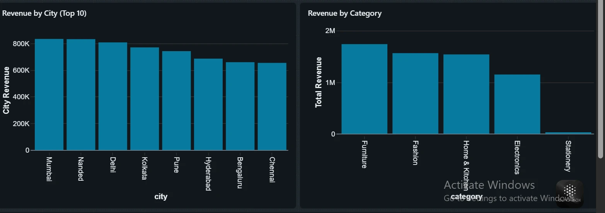
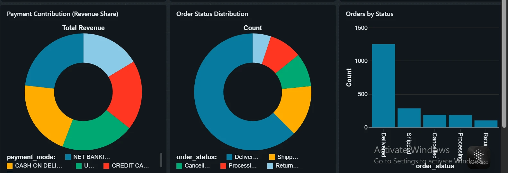
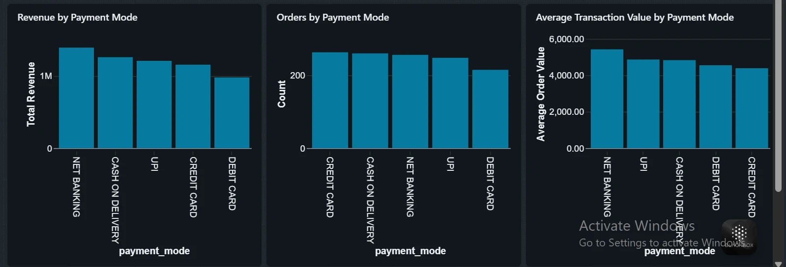
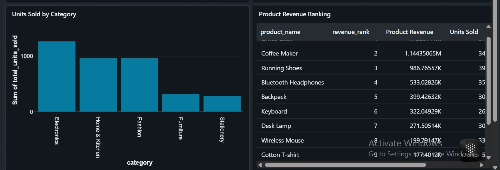

# E-Commerce Sales Data Engineering Pipeline

## Project Overview

This project demonstrates an end-to-end E-Commerce Sales Data Engineering Pipeline built using Databricks and Apache Spark.

The project focuses on processing e-commerce order data, organizing it through the Medallion Architecture, and creating business-focused analytics using a Databricks SQL Dashboard.

## Architecture

The project follows the Medallion Architecture:

- **Bronze Layer:** Stores raw source data.
- **Silver Layer:** Processes and cleans data.
- **Gold Layer:** Organizes transformed data for business analytics.

[View Project Architecture](docs/architecture.md)

## Technologies Used

- Databricks
- Apache Spark
- PySpark
- Delta Lake
- Lakeflow Spark Declarative Pipelines
- Auto Loader
- Unity Catalog
- Databricks SQL
- Medallion Architecture

## Dashboard Highlights

The interactive dashboard provides insights into:

- Total Orders and Delivered Orders
- Total Revenue and Average Order Value
- Delivery Rate and Order Status
- Revenue by City and Category
- Payment Mode Analysis
- Units Sold by Category
- Product Revenue Ranking

## Dashboard Screenshots

### 1. KPI Overview


### 2. Revenue Analysis


### 3. Payment and Order Status


### 4. Payment Mode Analysis


### 5. Product Performance


## Project Structure

```text
E-Commerce-Sales-Data-Engineering-Pipeline/
│
├── notebooks/
├── docs/
│   ├── architecture.md
│   └── E-Commerce-Project-Documentation.pdf
│
├── dashboard/
└── README.md
```

## Key Business Metrics

The dashboard displays:

| Metric | Dashboard Value |
|---|---:|
| Total Orders | 2K |
| Delivered Orders | 1.25K |
| Average Order Value | 4,818.57 |
| Units Sold | 3,772 |
| Delivery Rate | 62.5% |
| Cancelled Orders | 185 |
| Processing Orders | 182 |

*Values are displayed as shown in the dashboard and may be rounded.*

## Learning Outcomes

- Understanding data engineering workflows.
- Working with Apache Spark and PySpark.
- Implementing the Medallion Architecture.
- Building data pipelines in Databricks.
- Creating business-oriented dashboards.
- Analyzing sales, orders, products, and payment data.

## Author

**Samarth Amale**

Data Analytics & Data Engineering Aspirant

[GitHub](https://github.com/samarthamle) | [LinkedIn](https://www.linkedin.com/in/samarth-amale-744a7325a/)